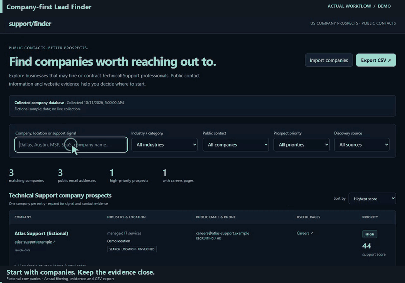

# Company-first Lead Finder

A Windows-oriented workflow for discovering companies, extracting published business contacts, preserving page evidence, and ranking technical-support prospects. Search categories alone do not earn score points.

The Python orchestration, scoring, directory adapters, Flask UI, and regression checks are included. Live search uses separately installed [OpenSERP](https://github.com/karust/openserp) and [Google Maps Scraper](https://github.com/gosom/google-maps-scraper); their code and binaries are not bundled. Optional browser enrichment uses Crawl4AI. Account databases and collected lead lists are excluded.

## Run

From this directory, create a virtual environment and install `requirements.txt` plus `requirements-standalone.txt`. Run `python -m unittest test_pipeline test_directories test_standalone -v` for offline checks. Run `python app.py --help` for discovery options.

For the local UI, run `python standalone.py --create-user demo`, then `python standalone.py`. The app writes fresh local account state under `data/`. Live collectors additionally require the native upstream executables at the paths used in `src/` and an installed Chrome browser. See those upstream projects for installation; portable runtimes from the source PC are not distributed here.

The GIF shows the actual evidence detector and scorer using fictional `.example` company pages. It does not show a live crawl or promise job availability.

## Demo

The demo records actual local interactions with fictional inputs. Cursor movement, camera zooms and captions are added for readability. See CREDITS.md for the exact recording setup.

## Source references

See [Credits and source references](CREDITS.md) for the upstream tools, libraries and fonts used, and details of the workflow recording.

[Download the full-motion recording](docs/demo.mp4).
